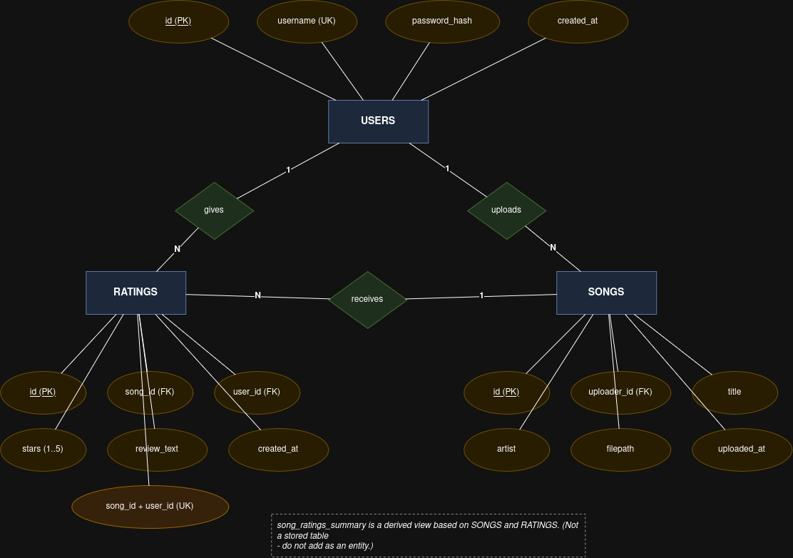

# Ngaithla teh

Ngaithla teh is a small community music library built with Flask, vanilla JavaScript, and MariaDB/MySQL. Users can create accounts, upload audio, browse tracks, and leave one editable star rating with an optional written review per song.

## Database ER Diagram

The database structure is documented using a Chen-notation-style ER diagram:



The editable diagrams.net source is available at [docs/database-erd.drawio](docs/database-erd.drawio).

## Requirements

- Python 3.10 or newer
- MariaDB on Linux or MySQL on Windows
- A database user that can create and modify the `music_app` database

PyMySQL is used for both database servers, so the application code is identical on Linux and Windows. Connection values come from environment variables or a local `.env` file.

## Linux: MariaDB setup

1. Install MariaDB and Python tooling:

   ```bash
   sudo apt update
   sudo apt install mariadb-server python3-venv
   sudo systemctl enable --now mariadb
   ```

2. Create the database and application user:

   ```bash
   sudo mariadb
   ```

   ```sql
   CREATE DATABASE music_app CHARACTER SET utf8mb4 COLLATE utf8mb4_unicode_ci;
   CREATE USER 'music_app'@'localhost' IDENTIFIED BY 'choose-a-password';
   GRANT ALL PRIVILEGES ON music_app.* TO 'music_app'@'localhost';
   FLUSH PRIVILEGES;
   EXIT;
   ```

3. Load the schema:

   ```bash
   mariadb -u music_app -p music_app < schema.sql
   ```

4. Create a virtual environment and install dependencies:

   ```bash
   python3 -m venv venv
   source venv/bin/activate
   pip install -r requirements.txt
   cp .env.example .env
   ```

5. Edit `.env` with the database password and a strong `SECRET_KEY`, then run:

   ```bash
   flask --app app run
   ```

   Open http://127.0.0.1:5000.

## Windows: MySQL setup

1. Install MySQL Community Server and MySQL Workbench (or the MySQL command-line client). During setup, remember the root password and keep the default port `3306` unless you have a reason to change it.

2. In MySQL Workbench or a MySQL shell, create the database and application user:

   ```sql
   CREATE DATABASE music_app CHARACTER SET utf8mb4 COLLATE utf8mb4_unicode_ci;
   CREATE USER 'music_app'@'localhost' IDENTIFIED BY 'choose-a-password';
   GRANT ALL PRIVILEGES ON music_app.* TO 'music_app'@'localhost';
   FLUSH PRIVILEGES;
   ```

3. From PowerShell in this project directory, load the schema. Adjust the MySQL executable path if needed:

   ```powershell
   mysql -u music_app -p music_app < schema.sql
   ```

4. Create a virtual environment and install dependencies:

   ```powershell
   py -m venv venv
   .\venv\Scripts\Activate.ps1
   pip install -r requirements.txt
   Copy-Item .env.example .env
   ```

5. Edit `.env` with the database password and a strong `SECRET_KEY`, then run:

   ```powershell
   flask --app app run
   ```

   Open http://127.0.0.1:5000.

## Configuration

The app reads `DB_HOST`, `DB_PORT`, `DB_NAME`, `DB_USER`, `DB_PASSWORD`, `SECRET_KEY`, and `UPLOAD_FOLDER`. `python-dotenv` is included so Flask loads values from `.env` when the Flask CLI starts. Never commit `.env` or uploaded media.

## Notes

- Uploaded files are stored in `uploads/`, which is created automatically and ignored by Git.
- The schema has a unique `(song_id, user_id)` key. Rating submissions use that key to update an existing rating instead of creating duplicates.
- The supplied schema's `CHECK (stars BETWEEN 1 AND 5)` constraint is supported by current MariaDB and MySQL releases.
